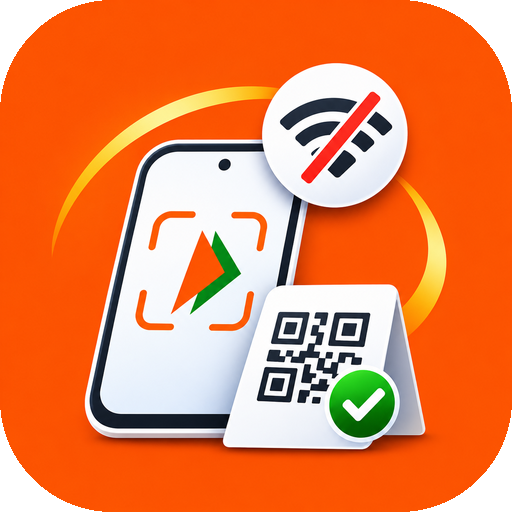

  

<h1 align="center">Support OfflinePay</h1>

  OfflinePay is free and open source. If it helps you pay when there's no internet, 
  you can help keep it going. Thank you! ❤️

## UPI, card and netbanking

Pay any amount through Razorpay's secure checkout:

**[razorpay.me/@bottercc](https://razorpay.me/@bottercc)**

## Crypto

| Network | Address |
|---|---|
| **BEP20** (BNB Smart Chain) | `0x16cc165aba41a150031760e6e351a9ba2aebce76` |
| **TRC20** (TRON) | `TDw25zSJem4NGvxMht2yXLdhkh4bQWtdtS` |
| **TON** | `UQAracXpb6gmYYyY_K-xKe64fSgmc6kSXmx3z7p-Q8RJ-Yr6` |
| **Bitcoin** | `1MWsGUysft8WCnjG5V4tDLxaDZg97sBZS1` |

> [!WARNING]
> Send only on the network shown next to each address. Crypto sent on the wrong network can't be recovered.

## Other ways to help

- ⭐ Star the repository
- 🐞 Report bugs, or share USSD transcripts from your bank and operator (remove personal details first)
- 📣 Tell friends and family who often lose mobile data

You can also donate from the website: [offlinepay.bottercc.com/donate](https://offlinepay.bottercc.com/donate)
