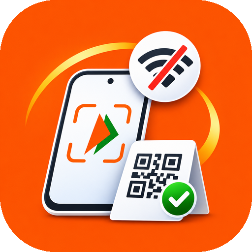

<p align="center">
  
</p>

<h1 align="center">OfflinePay</h1>

<p align="center">
  <b>UPI payments without internet, for Android.</b><br>
  A simple payment app on top of NPCI's <code>*99#</code> USSD service.
</p>

<p align="center">
  <a href="https://github.com/nasirul786/OfflinePay/releases/latest">Download APK</a> ·
  <a href="https://offlinepay.bottercc.com">Website</a> ·
  <a href="https://offlinepay.bottercc.com/donate">Donate</a>
</p>

---

## What it does

UPI over `*99#` works with no mobile data or Wi-Fi, just network signal. But using it normally means dialling a code and typing through text menus. OfflinePay gives you a regular payment app instead and runs the `*99#` steps for you in the background.

- **Pay anyone:** to a mobile number, a UPI ID or a bank account with IFSC
- **Scan & Pay:** scan any UPI QR code (scanning runs on the phone, so it works offline)
- **Check balance** and see your **recent bank transactions**
- **Request money** and **link a bank account**
- **Recent payments** with amount, time and UTR / Ref number
- Light and dark mode, iOS-style design

> Up to ₹5,000 per payment (the `*99#` limit). Your operator may charge up to ₹0.50 per session.

## Install

1. Download the APK from the [latest release](https://github.com/nasirul786/OfflinePay/releases/latest) and open it. Allow installing from unknown sources if Android asks.
2. Open OfflinePay, go through the intro, and agree to the [Terms](https://offlinepay.bottercc.com/terms/) and [Privacy Policy](https://offlinepay.bottercc.com/privacy/).
3. In **Settings → Permissions**, allow **Phone calls** and **SIM access**, then turn on **Accessibility** (Downloaded apps → OfflinePay).
4. Use the SIM whose number is registered with your bank.

**Xiaomi / Redmi / POCO:** HyperOS closes apps in the background, which stops the accessibility service ("This service is malfunctioning"). In **Settings → Background**, allow **Autostart** and set **Battery saver** to **No restrictions**.

Requires Android 8.0 (API 26) or newer.

## How it works

```
Your UI  ──►  dials *99#  ──►  system USSD dialog  ◄──►  Accessibility Service
                                                         reads each screen, picks the
                                                         matching option, types replies
```

1. The app places a `*99#` call on the chosen SIM (`TelecomManager.placeCall`).
2. `UssdAccessibilityService` reads each USSD screen and splits it into a prompt and numbered options.
3. `FlowScript` decides the reply by **keyword matching**, not fixed option numbers, because menus differ between banks and operators. Anything it doesn't recognise is handed to the user instead of guessed.
4. A full-screen overlay hides the raw menus and shows progress. Result screens are detected from their text, and the dialog is then closed.

Android only lets apps answer multi-step USSD menus through an Accessibility Service. `TelephonyManager.sendUssdRequest` handles single requests only.

## Privacy

- The **UPI PIN** is held in memory for one session only. It is never written to storage or logs, and it is never re-sent if the bank asks again.
- **Card details** are typed by you into the bank's dialog. The app never reads them.
- Payment history is stored **only on the phone**. There are no accounts, servers, analytics or crash reporting.
- Between payments, the accessibility service listens only to OfflinePay's own windows.
- The QR scanner uses Google ML Kit's bundled model. Images stay on the phone, but ML Kit may send anonymous usage statistics to Google when online. That's why the APK includes the internet permission; OfflinePay's own code never uses the network.

Full policy: [offlinepay.bottercc.com/privacy](https://offlinepay.bottercc.com/privacy/)

## Build from source

Requirements: JDK 17 and the Android SDK (API 36).

```bash
git clone https://github.com/nasirul786/OfflinePay.git
cd OfflinePay
./gradlew assembleDebug        # app/build/outputs/apk/debug/app-debug.apk
```

### Signed release

```bash
cp keystore.properties.example keystore.properties   # then fill in your key details
./gradlew assembleRelease      # app/build/outputs/apk/release/app-release.apk
```

Release builds are shrunk with R8 and include only ARM native libraries. Without `keystore.properties` they fall back to the debug key.

### Debugging USSD flows

Debug builds include an adb hook (`app/src/debug`) that starts flows without touching the screen and logs every dialog to logcat (tag `OfflinePayUSSD`). Flows stop at the PIN prompt; no PIN is ever sent.

```bash
adb shell am broadcast -n com.bottercc.offlinepay/.debug.DebugReceiver --es cmd transactions
adb shell am broadcast -n com.bottercc.offlinepay/.debug.DebugReceiver --es cmd send --es to someone@upi --es amount 1
adb shell am broadcast -n com.bottercc.offlinepay/.debug.DebugReceiver --es cmd cancel
```

## Project structure

```
app/src/main/java/com/bottercc/offlinepay/
├── ussd/          Dialer, accessibility service, USSD screen parser, flow scripts, overlay
├── data/          Local storage, statement / QR parsing
├── ui/            Jetpack Compose screens and iOS-style components
└── MainActivity.kt, MainViewModel.kt
app/src/debug/     adb test hook (debug builds only)
docs/              Website (GitHub Pages): landing, /privacy, /terms, /donate
```

Kotlin · Jetpack Compose · Material 3 · CameraX · ML Kit barcode scanning

## Contributing

Issues and pull requests are welcome, especially **USSD transcripts from other banks and operators**. Menu wording varies, and real screens are the best way to improve matching. When reporting, use the debug build's logcat output (`OfflinePayUSSD`) and **remove your account numbers, balances and any personal details first**.

## Support

OfflinePay is free. If it helps you, you can [support its development](https://offlinepay.bottercc.com/donate) via UPI, card, netbanking or crypto.

## Disclaimer

OfflinePay is an independent project. It is not affiliated with or endorsed by NPCI, any bank or any mobile operator. Payments are processed by your bank and NPCI. Always check the payee and amount before entering your PIN. See the [Terms of Use](https://offlinepay.bottercc.com/terms/).

## License

[MIT](LICENSE) © 2026 bottercc
